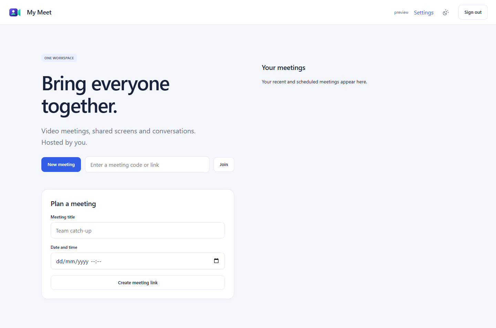

<p align="center"></p>

# My Meet

Video meetings in One Workspace. **Meet.exe** embeds the open source
[LiveKit](https://github.com/livekit/livekit) media server and uses the Workspace
design system and MyAccounts identity.



## Run

Download the Windows ZIP from [Releases](https://github.com/oneworkspacestudio/my-meet/releases),
extract into a dedicated NTFS folder and run **Meet.exe**. One launch starts the
browser app and the bundled media engine. Docker, Node and Go are not required.
The verified engine is extracted under the protected `data/engine` directory
and supervised in a Windows job; it is a child process, not a second manual install.

Standalone mode offers a one-time local owner setup. In One Workspace, `/meet/`
uses your MyAccounts login automatically and stores private state under `Data/meet`.
Participants need a local/managed account. Meeting codes do not bypass identity or
host approval.

## Included

- Instant meetings and dated meeting links.
- Device preview, microphone/camera controls and device selection.
- Real LiveKit WebRTC audio/video; adaptive stream selection.
- Host admission lobby, lock/unlock, participant removal, host mute and end for all.
- Screen sharing, participant grid and pinning.
- Persistent meeting chat, raise hand and applause reactions.
- Browser-selected local screen recording to WebM (where supported). The browser
  controls included audio; recording is announced in meeting chat.
- Responsive layouts, light/dark theme, Workspace launcher, encrypted backups.

## Remote access

The web page and authenticated signalling work through the Workspace HTTPS tunnel.
**Media requires a separate reachable network path.** Cloudflare's HTTP tunnel
does not carry LiveKit UDP/TCP media.

At the default app port 9016, forward UDP **10017** and TCP **10018** to this PC,
allow those ports through Windows Firewall, and set `MYMEET_EXTERNAL_IP=true` in
the server environment before starting it. With `--listen` on another port, the
media ports are listener +1001 (UDP) and +1002 (TCP). Settings shows the actual ports.
The engine HTTP/admin endpoint remains on loopback at listener +1000.

Networks that block direct media require a separately reachable TURN service.
No paid service is enabled automatically. See [LiveKit's deployment guide](https://docs.livekit.io/transport/self-hosting/deployment/).
Do not advertise unrestricted remote calling until the installed network has
passed a real external-device call.

## Preview boundaries

This is **not full Google Meet parity**. The configured room limit is 32 participants;
that is a ceiling, not a tested capacity claim. This release does not provide
anonymous guest access, dial-in numbers, breakout rooms, polls/Q&A, cloud recordings,
server captions/transcription, translated captions, background segmentation,
whiteboards or Google Calendar integration. Local recording captures the user-chosen
screen, not a guaranteed server-side composite. Upload downloaded recordings to Drive.
Physical camera/audio quality, external NAT paths and large meetings need installation
acceptance. It is not end-to-end encrypted: the self-hosted media server handles tracks.

## Build and provenance

Go 1.27.2, Node 26, PowerShell 7:

```powershell
$env:MYMEET_ENGINE_CACHE = './dist/cache'
./scripts/prepare-engine.ps1
./scripts/build.ps1 -Go go -Npm npm.cmd -Output ./dist/release
```

`engine.lock.json` pins the official LiveKit 1.13.10 Windows artifact and executable
SHA256. `scripts/engine-notices.py` inventories its Go dependencies and licence texts.
The frontend uses pinned LiveKit client 2.23.0. Product screens are AUI sources compiled
with `@codedia/parser`. Windows releases are built locally; no GitHub Actions.
See `NOTICE`, `SECURITY.md` and `docs/LIVEKIT-LICENSE.txt`. Not affiliated with Google.
